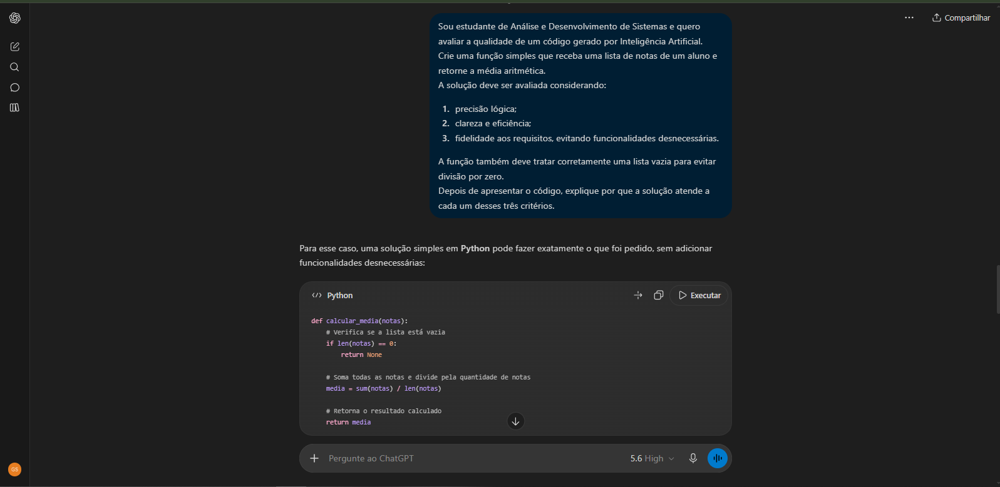
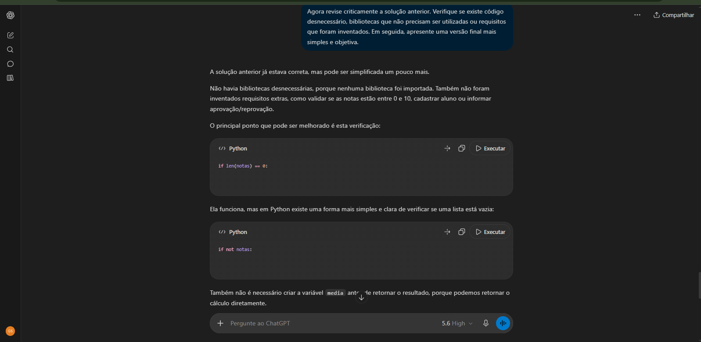

# ⎘ Avaliação de Código com Inteligência Artificial

<p>
  
  
  
</p>

Projeto acadêmico relacionado à **avaliação crítica de código produzido com apoio de Inteligência Artificial**, observando aspectos relacionados à precisão lógica, clareza, eficiência e fidelidade aos requisitos apresentados.

Como caso de estudo, foi utilizado um problema simples de programação: desenvolver uma função capaz de receber uma lista de notas e calcular sua média aritmética.

Mais do que obter uma resposta funcional, o objetivo foi analisar se a solução gerada realmente atendia ao problema proposto de maneira simples, correta e sem adicionar funcionalidades desnecessárias.

---

## ⎙ Objetivo do projeto

O objetivo deste projeto foi compreender que uma resposta produzida por uma Inteligência Artificial não deve ser aceita automaticamente apenas porque aparenta estar correta.

A solução foi analisada considerando três critérios principais:

- ☉ precisão lógica;
- ☉ clareza e eficiência;
- ☉ fidelidade aos requisitos apresentados.

Propomos também desenvolver uma postura mais crítica ao utilizar ferramentas de IA durante atividades de programação.

---

## ꕤ Conceitos trabalhados

Durante o projeto foram explorados conceitos relacionados a:

- ⊹ Inteligência Artificial Generativa;
- ⊹ Avaliação crítica de respostas de IA;
- ⊹ Qualidade de código;
- ⊹ Lógica de Programação;
- ⊹ Validação e testes;
- ⊹ Eficiência;
- ⊹ Legibilidade;
- ⊹ Fidelidade aos requisitos;
- ⊹ Uso responsável de Inteligência Artificial.

---

## ☟ Problema proposto

O problema utilizado como exemplo foi:

> Desenvolver uma função que receba uma lista de notas representadas por números reais e retorne a média aritmética dessas notas.

Além disso, a solução deveria tratar corretamente uma lista vazia para evitar erros relacionados à divisão por zero.

---

## 〽︎ Critérios de avaliação

### ① Precisão lógica

Este critério verifica se o código realmente executa aquilo que foi solicitado.

Foram observados pontos como:

- ⊹ cálculo correto da média;
- ⊹ tratamento de listas vazias;
- ⊹ funcionamento com valores decimais;
- ⊹ retorno coerente com os dados fornecidos.

---

### ② Clareza e eficiência

Além de funcionar corretamente, o código deve ser compreensível e evitar informações desnecessária.

Foram considerados:

- ⊹ nomes de variáveis claros;
- ⊹ estrutura simples;
- ⊹ ausência de loops desnecessários;
- ⊹ utilização adequada de funções nativas;
- ⊹ comentários somente quando agregam contexto.

---

### ③ Fidelidade aos requisitos

Um dos riscos ao utilizar IA é receber uma resposta ou solução que adiciona funcionalidades que não foram solicitadas.

Neste projeto, foi analisado se a solução permanecia fiel ao problema original.

Por exemplo, não havia necessidade de:

- ⊹ criar interface gráfica;
- ⊹ utilizar banco de dados;
- ⊹ realizar requisições web;
- ⊹ instalar bibliotecas externas;
- ⊹ criar classes complexas;
- ⊹ adicionar funcionalidades fora do escopo.

Esse critério ajuda a observar possíveis **alucinações de requisitos** produzidas durante a geração de código por IA.

---

## ⌨︎ Implementação

A solução principal está disponível no arquivo:

`calculo_media.py`

O funcionamento da primeira parte pode ser mostrado da seguinte forma:

```python
def calcular_media(notas: list[float]) -> float:

    if not notas:
        return 0.0

    soma_notas = sum(notas)
    quantidade_notas = len(notas)

    return soma_notas / quantidade_notas
```

A verificação:

```python
if not notas:
    return 0.0
```

impede uma tentativa de divisão por zero quando uma lista vazia é fornecida.

---

## ✔︎ Validação da solução

Além da implementação, foram adicionados testes automatizados no arquivo:

`test_calculo_media.py`

Entre os cenários analisados estão:

- ⊹ lista normal de notas;
- ⊹ lista vazia;
- ⊹ somente uma nota;
- ⊹ valores decimais.

Isso permite verificar se o comportamento esperado continua correto após alterações no código.

---

## 🅾︎ Demonstração da interação com IA

Como a conversa original realizada durante a atividade não estava mais disponível, foram recriadas interações seguindo a mesma proposta acadêmica.

As imagens abaixo possuem finalidade demonstrativa.

### ❇︎ Etapa 1 — Geração e avaliação da solução

Nesta interação, a IA recebeu o problema e os critérios que deveriam ser considerados durante a elaboração da solução.

<p align="center">
  
</p>

---

### ❇︎ Etapa 2 — Revisão crítica

Na segunda etapa, foi solicitado que a IA revisasse a própria solução, buscando código desnecessário, requisitos inventados ou oportunidades de simplificação.

<p align="center">
  
</p>

---

## 〽︎ Resultado da avaliação

| Critério | Verificação | Resultado |
| :--- | :--- | :--- |
| **Precisão lógica** | Cálculo correto da média e tratamento de lista vazia | ✔︎ Atendido |
| **Clareza** | Variáveis descritivas e estrutura simples | ✔︎ Atendido |
| **Eficiência** | Uso de `sum()` e `len()` sem processamento desnecessário | ✔︎ Atendido |
| **Fidelidade ao requisito** | Não adiciona funcionalidades fora do problema | ✔︎ Atendido |
| **Validação** | Testes para diferentes cenários | ✔︎ Atendido |

---

## ✏︎ O que aprendi

Durante esta atividade, percebi que ao utilizar Inteligência Artificial para gerar código exige também capacidade de análise e revisão.

Uma solução produzida por IA pode parecer correta visualmente, mas ainda precisa ser verificada em relação à lógica, eficiência, clareza e principalmente aos requisitos apresentados.

Também compreendi que uma solução mais complexa não significa necessariamente uma solução melhor.

Em problemas simples, utilizar recursos desnecessários ou adicionar funcionalidades que não foram solicitadas pode prejudicar a qualidade do código.

Essa atividade contribuiu para desenvolver uma visão mais crítica sobre o uso de **Inteligência Artificial aplicada ao desenvolvimento de software**, mostrando que o desenvolvedor continua sendo responsável por validar e compreender o código utilizado.

---

## ⚒︎ Tecnologias e ferramentas

<p>
  
  
  
  
</p>

Neste projeto, Python é utilizado apenas como recurso prático para demonstrar e validar os conceitos de **avaliação de código com apoio de Inteligência Artificial**.

---

## ▤ Estrutura do repositório

```text
avaliacao-de-codigo-com-ia/
│
├── imagens/
│   ├── IA-AVALIACAO-1.png
│   └── IA-AVALIACAO-2.png
│
├── .gitignore
├── LICENSE
├── README.md
├── calculo_media.py
└── test_calculo_media.py
```

### Descrição dos arquivos

| Arquivo | Finalidade |
| :--- | :--- |
| `README.md` | Documentação principal do projeto |
| `calculo_media.py` | Implementação analisada durante o projeto |
| `test_calculo_media.py` | Testes utilizados para validar a solução |
| `.gitignore` | Arquivos que não devem ser versionados |
| `LICENSE` | Licença MIT |
| `imagens/` | Demonstrações visuais das interações |

---

## ▶︎ Como executar

### 1. Clone o repositório

```bash
git clone https://github.com/ErenDEV-ctrl/avaliacao-de-codigo-com-ia.git
```

### 2. Entre na pasta

```bash
cd avaliacao-de-codigo-com-ia
```

### 3. Execute o programa

```bash
python calculo_media.py
```

### 4. Execute os testes

```bash
python -m unittest test_calculo_media.py
```

Não é necessária a instalação de bibliotecas externas.

---

## 🎓 Contexto acadêmico

Projeto desenvolvido durante a graduação em **Análise e Desenvolvimento de Sistemas — ADS** em uma atividade relacionada à utilização e avaliação de ferramentas de Inteligência Artificial no desenvolvimento de software.

O conteúdo foi posteriormente reorganizado e documentado para integrar meu **portfólio acadêmico e profissional no GitHub**.

---

## ◌ Próximos estudos

Pretendo aprofundar meus conhecimentos em:

- ⊹ Inteligência Artificial aplicada ao desenvolvimento;
- ⊹ Avaliação de respostas produzidas por IA;
- ⊹ LLMs;
- ⊹ Engenharia de Prompt;
- ⊹ Uso responsável de IA;
- ⊹ Testes e validação de software;
- ⊹ Automação utilizando Inteligência Artificial.

---

## 📄 Licença

Este projeto está disponibilizado sob a **MIT License**.

Consulte o arquivo [`LICENSE`](./LICENSE) para mais informações.

---

## ✉︎ Autor

**Gabriel Silva**  
Estudante de **Análise e Desenvolvimento de Sistemas — ADS**  
Foco de estudos em **Inteligência Artificial** 🤖

<a href="https://www.linkedin.com/in/gabriel-silva-6325953a7/" target="_blank">
  
</a>

---

<p align="center">
  Desenvolvido para fins acadêmicos e de aprendizado.
</p>
